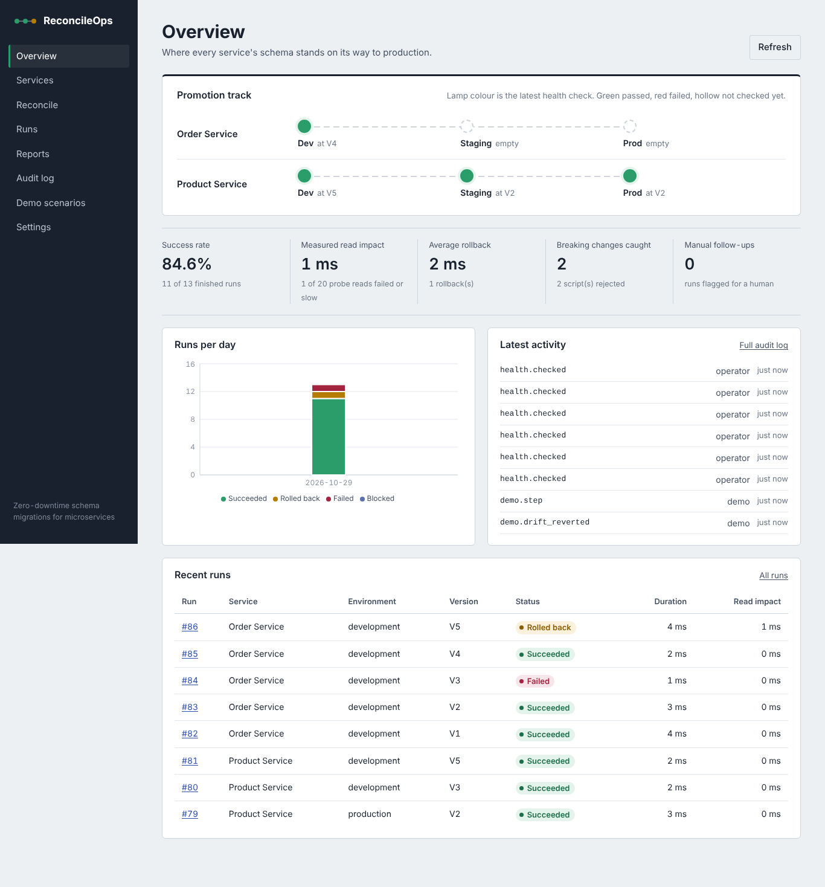

# ReconcileOps

Automated zero-downtime schema migration framework for microservices.

ReconcileOps manages database schema changes for services like a small CI/CD pipeline.
You write versioned migration scripts, it checks them for breaking changes, runs them
safely against development → staging → production, measures whether live reads were
affected, runs health checks afterwards, and rolls back when a check fails and a down
script exists.

* React + Vite frontend (React Router, Recharts)
* Node.js + Express REST API
* PostgreSQL: one database for ReconcileOps' own data, a separate one as the migration target
* Flyway for the metadata schema
* Docker Compose, GitHub Actions, Vitest, Supertest, Playwright



## Run it with Docker (easiest)

You need Docker Desktop (or Docker Engine with the compose plugin).

```bash
cp .env.example .env          # then change the two passwords
docker compose up --build
```

Open **http://localhost:8080**, go to **Demo scenarios**, click **Reset demo data**
and run the steps in order.

What starts:

| Service | Purpose | Port |
|---|---|---|
| `meta-db` | PostgreSQL 16, ReconcileOps metadata | internal |
| `demo-db` | PostgreSQL 16, the database migrations run against | internal |
| `flyway` | Applies `backend/db/migrations` to `meta-db`, then exits | |
| `backend` | Express API | 4000 |
| `frontend` | nginx serving the built React app, proxies `/api` | 8080 |

Stop with `Ctrl+C`. `docker compose down -v` also deletes the data volumes.

## Run it without Docker

You need Node.js 20+ and PostgreSQL 14+ running locally.

```bash
# 1. create the two databases
createdb reconcileops_meta
createdb reconcileops_demo

# 2. backend
cd backend
cp .env.example .env          # adjust user/password if yours differ
npm install
npm run migrate               # uses the Flyway CLI if installed, otherwise applies the same SQL files
npm run dev                   # http://localhost:4000

# 3. frontend (new terminal)
cd frontend
npm install
npm run dev                   # http://localhost:5173
```

On Windows, if `createdb` isn't on your PATH, run
`CREATE DATABASE reconcileops_meta;` and `CREATE DATABASE reconcileops_demo;` in pgAdmin or psql.

## Deploy it online (Render)

`render.yaml` describes the whole stack: one PostgreSQL server, the API and the frontend.

1. Push this repo to GitHub.
2. On [render.com](https://render.com): **New → Blueprint**, pick the repo, click **Apply**.
3. Open `https://reconcileops.onrender.com`. The demo is loaded automatically on the first start.

The API starts with `backend/scripts/render-start.js`, which creates the demo database on the
same server, applies the migrations and seeds the demo. Viewing is open; write actions need the
generated `API_TOKEN` (reconcileops-api → Environment), which you paste on the Settings page.
If Render assigns the API a different URL, update the `/api/*` rewrite in `render.yaml`.
Free-tier services sleep when idle (first request takes ~1 minute) and the free database expires after 30 days.

## Tests

```bash
# backend unit tests (no database needed)
cd backend && npm run test:unit

# backend integration tests: need two empty throwaway databases (they get wiped)
createdb rops_meta_test && createdb rops_demo_test
npm run test:integration      # reads TEST_META_DATABASE_URL / TEST_DEMO_DATABASE_URL from .env

# frontend component tests
cd frontend && npm test

# end-to-end browser tests: start the app first (Docker or npm run dev)
cd e2e
npm install
npx playwright install chromium
npx playwright test                         # against http://localhost:5173
E2E_BASE_URL=http://localhost:8080 npx playwright test   # against Docker
```

Results from my last run on this code: 22 backend unit, 18 backend integration,
8 frontend component and 8 end-to-end tests, all passing against PostgreSQL 16.
The Docker images and the GitHub Actions workflow were written but not executed,
because the environment I built this in had no Docker daemon. Run
`docker compose up --build` once and check the Actions tab after your first push.

## The demo

Two services, each with three environment schemas in the demo database.

**Product Service**: changing `price NUMERIC` to `price_cents INTEGER` without downtime.

| Step | What happens | Expected result |
|---|---|---|
| Baseline | V1 creates `products`, promoted dev → staging → prod | success |
| Expand | V2 adds `price_cents`, backfills, adds a sync trigger | success |
| App v2.0 | Registers a new app version that reads `price_cents` | |
| Migrate | V3 makes `price_cents` NOT NULL with a short-lock pattern | success with warning |
| Incompatible | V4 renames `name` → `title` directly | **rejected** by validation |
| Contract too early | V5 drops `price` while app v1.0 still reads it | **rejected** |
| Retire v1.0, contract | V5 again after v1.0 is retired | success |

**Order Service**: failure handling.

| Step | What happens | Expected result |
|---|---|---|
| Baseline + index | V1 table, V2 `CREATE INDEX CONCURRENTLY` (runs outside a transaction) | success |
| Failed migration | V3 adds `CHECK (quantity > 0)`, but a legacy row has 0 | **fails**, transaction rolled back, schema unchanged |
| Recover | V3 marked rejected, V4 fixes the data then adds the constraint | success |
| Health rollback | V5 hides a column rename inside a `DO` block. It runs, the v1.0 read probe fails, the down script restores the column | **rolled back** automatically |

**Reconciliation**: a step adds a column directly in the database (a "hotfix"). The
Reconcile page shows drift, and the plan is blocked until it's reverted.

Every result you see comes from the database. Nothing is hardcoded.

## Main features and where to find them

| Feature | Screen | Code |
|---|---|---|
| Metrics, environment health | Overview | `routes/misc.js` → `/dashboard`, `services/metrics.js` |
| Services, schema versions per environment | Services → a service → Environments | `routes/projects.js` |
| Script management, schema comparison | Migration scripts, Compare schemas tabs | `routes/projects.js`, `services/schemaDiff.js` |
| Validation and breaking-change detection | Validate button | `services/validator.js`, `services/validation.js` |
| Execution on the isolated demo DB | Run button | `services/executor.js` |
| Expand and contract | Demo, Product Service | `services/demoData.js` |
| Health monitoring, consistency checks | Environments tab, Health history | `services/health.js` |
| Failure handling, retries, rollback, audit | Runs → run detail, Audit log | `services/executor.js`, `services/audit.js` |
| Charts, filters, CSV export | Reports | `services/metrics.js` |
| Settings, environment protection, API token | Settings | `services/settings.js`, `middleware.js` |
| Reconciliation engine | Reconcile | `services/reconcile.js`, `services/desired.js` |

## Technical decisions, in plain words

**Two databases.** The metadata DB is ReconcileOps' memory. The demo DB is the thing
being changed. Keeping them apart means a broken demo migration can never damage the
tool's own records, and the app refuses to start if both URLs are the same.

**One schema per environment.** `product_service_staging` and friends live in the
demo database. It's a cheap stand-in for separate servers.

**Flyway for the metadata DB, a built-in executor for the demo DB.** Flyway is the
standard tool for versioned SQL and is used where it fits: setting up ReconcileOps
itself. The demo scripts are run by ReconcileOps' own executor because that's where
the interesting work happens: probes during execution, health checks, automatic
rollback, retries and promotion rules. It follows Flyway's conventions (ordered
versions, checksums, a history table per schema).

**Transactions do most of the safety work.** PostgreSQL can roll back DDL. Each script
runs inside one transaction with `lock_timeout` and `statement_timeout`, so a failing
script leaves the schema exactly as it was. That's also how the dry run works: run
the script for real, then `ROLLBACK`.

**Rollback is never assumed.** A down script is optional. Without one, the UI says
auto-rollback isn't possible, and an unhealthy run is flagged for manual review
instead of being silently "fixed". Only the newest version can be rolled back.

**Duplicates and concurrency are blocked in the database itself.** Two partial unique
indexes mean only one run per service/environment can be `running`, and a script can
succeed only once per environment. A PostgreSQL advisory lock on the target schema
adds a second guard.

**No unsafe automatic SQL.** Only validated scripts run. Scripts can't change roles,
search_path or permissions, touch other schemas, run shell commands via `COPY PROGRAM`,
read files, or manage transactions. Warnings must be acknowledged. Production needs
the service slug typed in, and a version must pass the previous environment first.

**Downtime is measured, not claimed.** While a script runs, a second connection keeps
running the SELECT each live app version depends on. Failed or slow (>250 ms) reads
are added up as "read impact". Zero means none was observed during that run.

## Configuration

Root `.env` (Docker) and `backend/.env` (local) are documented in their `.env.example`
files. Secrets stay on the server: the Settings page shows connection strings with
the password masked. Set `API_TOKEN` to require `Authorization: Bearer` on every write.

## Documentation

* [docs/ARCHITECTURE.md](docs/ARCHITECTURE.md): architecture and sequence diagrams, reconciliation engine, research paper vs implementation
* [docs/ER-DIAGRAM.md](docs/ER-DIAGRAM.md): metadata database model
* [docs/API.md](docs/API.md): every endpoint
* [docs/DEPLOYMENT.md](docs/DEPLOYMENT.md): free hosting options and their limits, step-by-step deploy

## Checklist

Done:

- [x] Overview dashboard with real metrics and environment health
- [x] Services, scripts, versions per environment, immutable applied scripts with checksums
- [x] Schema comparison (desired or any environment against any other)
- [x] Static validation, compatibility checks against live app versions, dry run on real data
- [x] Execution against an isolated demo database with timeouts, retries and advisory locks
- [x] Expand/migrate/contract phases and a full expand-and-contract demo
- [x] Post-deploy health checks (compatibility probes, checksums, index validity, schema consistency)
- [x] Automatic rollback on failed health checks, manual rollback, retry, audit log
- [x] Reports with charts, filters and CSV export
- [x] Settings, protected environments, promotion order, optional API token
- [x] Reconciliation engine with drift detection and an apply-plan action
- [x] Product Service and Order Service demo with successful, incompatible, failed and rolled-back migrations
- [x] Responsive UI with loading, empty, success and error states
- [x] Unit, integration and end-to-end tests
- [x] Dockerfiles, Docker Compose, GitHub Actions, `.env.example`, API docs, diagrams

Limitations (please read before presenting):

- Validation is pattern-based, not a full SQL parser. It's strict on purpose and warns
  about anything it can't read (like `DO` blocks), but it can still miss things. The
  dry run and health checks are the second line of defence.
- Environments are schemas on one demo server, not separate infrastructure.
- Read impact is measured with synthetic probe queries, not real user traffic. Demo
  tables are tiny, so most runs show 0 ms. That's an honest result, not proof that
  every migration is downtime-free.
- Down scripts are written by hand. A rollback can't bring back dropped data unless
  the down script recreates it (V5's down rebuilds `price` from `price_cents`).
- `CREATE INDEX CONCURRENTLY` failures can leave an invalid index that needs manual cleanup.
- Single-user tool: the API token is one shared secret, not per-user accounts.
- The EvolveDB paper wasn't in the material I received, so the research comparison in
  ARCHITECTURE.md needs checking against the paper.
- Docker images and the CI workflow haven't been run yet (see Tests).
