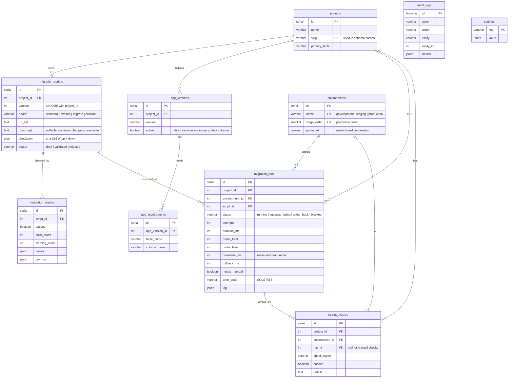

# Metadata database: ER diagram

Defined in `backend/db/migrations/V1__metadata_schema.sql` and applied by Flyway.

## Constraints that do real work

| Constraint | Purpose |
|---|---|
| `uq_one_running_run` (partial unique index on `project_id, environment_id WHERE status='running'`) | Only one migration can run per service and environment at a time. A second request gets 409. |
| `uq_script_success_once` (partial unique on `script_id, environment_id WHERE status='success'`) | A script cannot succeed twice in the same environment. |
| `UNIQUE (project_id, version)` | Version numbers can't repeat within a service. |
| `CHECK` on `status`, `phase`, `slug` | The database rejects invalid states even if the API had a bug. |
| `ON DELETE CASCADE` from projects | Deleting a service removes its scripts, runs and health history together. |

## Per-environment history table (demo database)

Each environment schema also has `rops_schema_history`
(`version PK, description, checksum, phase, applied_at, execution_ms`). It is written in
the same transaction as the migration, so it can't disagree with the actual schema
change. The reconciliation engine compares it with `migration_runs`.
